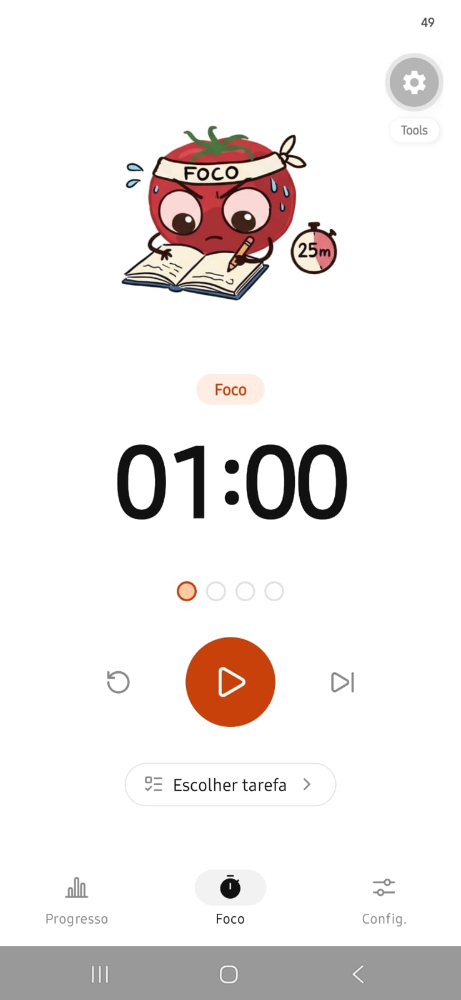
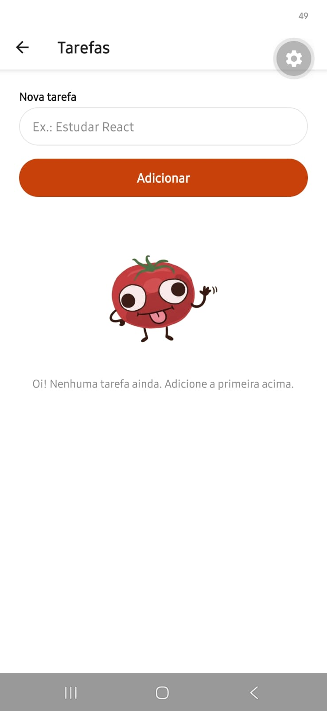
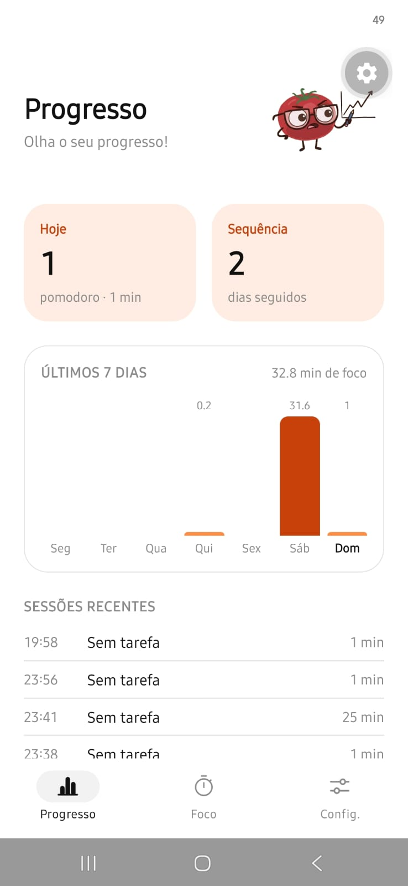
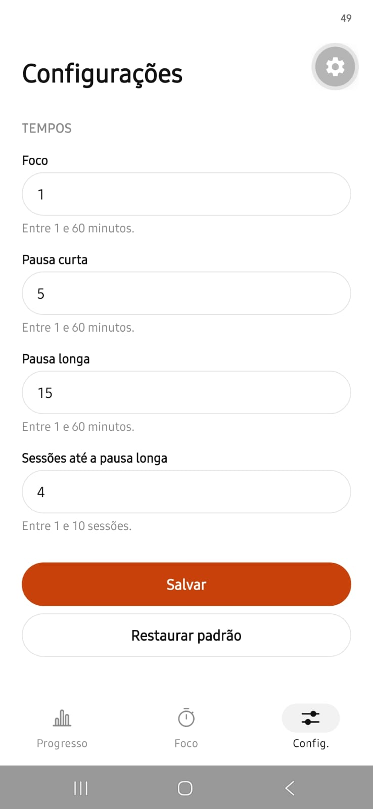

# 🍅 Pomodoro com o Tomatín

Aplicativo mobile de foco baseado na **técnica Pomodoro**, feito com **React Native + Expo** como trabalho da disciplina.

O usuário alterna blocos de foco com pausas curtas e longas, escolhe em qual tarefa está trabalhando e acompanha o próprio progresso ao longo da semana. Tudo isso com a companhia do **Tomatín**, o mascote que muda de humor conforme o momento.

**Aluno:** João Gabriel Lack Santos

---

## 📱 Telas

| Timer | Tarefas | Progresso | Configurações |
|:---:|:---:|:---:|:---:|
|  |  |  |  |

### 1. Timer (aba central)
A tela principal. Mostra o tempo restante da etapa atual (foco, pausa curta ou pausa longa) e permite **iniciar, pausar, reiniciar e pular** etapas. Os tomatinhos indicam quantos focos já foram feitos no ciclo atual. Ao fim de cada ciclo vem uma pausa longa. Logo abaixo aparece a tarefa em foco, e um toque abre a tela de Tarefas.

### 2. Tarefas (modal)
Abre por cima do Timer. Tem um **formulário para criar tarefas, com validação**: o nome não pode ser vazio, deve ter no máximo 60 caracteres e não pode repetir uma tarefa existente. As tarefas aparecem numa lista, onde é possível **concluir, remover e escolher a tarefa em foco**.

### 3. Progresso (aba da esquerda)
Resumo do dia (pomodoros e minutos de foco), **sequência de dias seguidos**, **gráfico de barras dos últimos 7 dias** e uma lista com as **sessões recentes**, cada uma com o horário, a tarefa e a duração.

### 4. Configurações (aba da direita)
Formulário para ajustar a duração do **foco**, da **pausa curta**, da **pausa longa** e o **número de sessões até a pausa longa**, com validação de cada campo (apenas números inteiros, dentro de limites).

---

## ✨ Funcionalidades

- Cronômetro Pomodoro que continua certo mesmo se o app for para segundo plano
- Ciclos automáticos de foco, pausa curta e pausa longa
- Tarefas com conclusão, remoção e seleção da tarefa em foco
- Histórico de sessões ligado às tarefas (com o aviso "Tarefa excluída" quando a tarefa é removida)
- Estatísticas do dia, da semana e sequência de dias
- Durações personalizáveis
- **Dados salvos no celular** (sessões, tarefas e configurações continuam lá depois de fechar o app)
- Mascote Tomatín com uma pose diferente para cada momento

---

## ✅ Requisitos do trabalho

| Requisito | Onde está no projeto |
|---|---|
| Projeto Expo executável no Expo Go | Expo SDK 58 |
| Mínimo de 4 telas com navegação | Timer, Tarefas, Progresso e Configurações, com **Expo Router** (abas nativas + modal) |
| Componentes reutilizáveis próprios | `Button`, `TextField`, `TaskCard`, `TimerDisplay`, `TimerControls`, `SessionDots`, `WeeklyChart`, `SessionRow` (em `src/components/`) |
| `useState` e `useEffect` | Em todas as telas. Destaque para o hook `useTimer` (`src/hooks/use-timer.ts`) e o Context (`src/context/app-data.tsx`) |
| Listagem com `FlatList` | Lista de tarefas e lista de sessões recentes |
| Formulário com `TextInput` e validação | Nova tarefa (`src/utils/tasks.ts`) e Configurações (`src/utils/settings.ts`) |
| Estilização com `StyleSheet` e identidade visual | Tema central em `src/theme/` (cores, espaçamentos, bordas) usado por todas as telas |
| Repositório no GitHub com README | Este arquivo |
| **Bônus:** persistência local com `AsyncStorage` | `src/storage/storage.ts` e `src/context/app-data.tsx` |

---

## 🚀 Como rodar o projeto

### Pré-requisitos
- [Node.js](https://nodejs.org/) (versão LTS)
- O app **Expo Go** no celular ([Android](https://play.google.com/store/apps/details?id=host.exp.exponent) / [iOS](https://apps.apple.com/app/expo-go/id982107779)), compatível com o **Expo SDK 58**
- Celular e computador **na mesma rede Wi-Fi**

### Passo a passo

1. Clone o repositório e entre na pasta:
   ```bash
   git clone https://github.com/joaolack/pomodoro-app.git
   cd pomodoro-app
   ```

2. Instale as dependências:
   ```bash
   npm install
   ```

3. Inicie o servidor de desenvolvimento:
   ```bash
   npx expo start
   ```

4. Abra o app:
   - **Android:** abra o Expo Go e escaneie o QR code que aparece no terminal.
   - **iOS:** escaneie o QR code com a câmera do iPhone.
   - **Emulador:** com um emulador Android aberto, pressione `a` no terminal.

> **Dica para testar:** nas Configurações, coloque **Foco = 1** e **Pausa curta = 1** para ver o ciclo completo em poucos minutos.

---

## 🛠️ Tecnologias

- [React Native](https://reactnative.dev/) e [Expo](https://expo.dev/) (SDK 58)
- [TypeScript](https://www.typescriptlang.org/)
- [Expo Router](https://docs.expo.dev/router/introduction/), com navegação por arquivos, abas nativas (`NativeTabs`) e modal
- [AsyncStorage](https://docs.expo.dev/versions/latest/sdk/async-storage/) para salvar os dados no celular
- [expo-image](https://docs.expo.dev/versions/latest/sdk/image/) para as ilustrações
- [Lucide](https://lucide.dev/) (`@react-native-vector-icons/lucide`) para os ícones

---

## 📂 Estrutura do projeto

```
src/
├── app/                 # Telas (cada arquivo é uma rota do Expo Router)
│   ├── _layout.tsx      # Stack raiz + Provider dos dados
│   ├── tasks.tsx        # Tarefas (modal)
│   └── (tabs)/
│       ├── _layout.tsx  # Barra de abas
│       ├── index.tsx    # Timer
│       ├── progress.tsx # Progresso
│       └── settings.tsx # Configurações
├── components/          # Componentes reutilizáveis (cada um com index.tsx + styles.ts)
├── constants/           # Valores padrão e imagens do mascote
├── context/             # Context com sessões, tarefas e configurações
├── hooks/               # useTimer: toda a lógica do cronômetro
├── storage/             # Funções de salvar/carregar no AsyncStorage
├── theme/               # Cores, espaçamentos e bordas
├── types/               # Tipos TypeScript (Task, Session, Settings)
└── utils/               # Funções puras: formatação, validação e estatísticas
```

Uma explicação mais detalhada de como o Context e o AsyncStorage funcionam no app está em [`docs/context-e-asyncstorage.md`](docs/context-e-asyncstorage.md).

---
